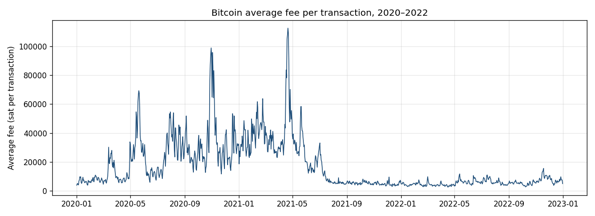

# Week 2 — Niels: data preparation (report)

Notebook: `notebooks/01_prepare_data.ipynb` · Output: `data/processed/bitcoin_daily.csv`

## Data checks

Raw file `data/raw/coinmetrics_btc_daily.csv` (Coin Metrics, 2020-01-01 → 2024-12-31):

| Check | Result |
| --- | --- |
| Rows | 1,827 ✅ |
| Duplicate dates | 0 |
| Missing dates | 0 |
| Missing `FeeTotNtv` / `TxCnt` | 0 / 0 |
| Days with `TxCnt = 0` | 0 |
| Days where the fee cannot be computed (flag `fee_invalid`) | 0 |

Fee: `fee_sat = 100_000_000 * FeeTotNtv / TxCnt` (satoshis per transaction).

## Clean dataset — `data/processed/bitcoin_daily.csv`

One row per `target_date`, 17 columns:

- `target_date`, `split` (`train` / `validation` / `test`)
- `actual_fee_sat`: observed fee on the target date (the value to predict)
- `fee_lag_1_sat` … `fee_lag_7_sat`: fee 1 to 7 calendar days before
- `txcnt_lag_1` … `txcnt_lag_7`: transaction count 1 to 7 calendar days before

| Split | Target dates | Rows |
| --- | --- | --- |
| train | 2020–2022 | 1,089 |
| validation | 2023 | 365 |
| test | 2024 | 366 |
| **Total** | | **1,820** |

**Removed: 7 rows** (target dates 1–7 January 2020, not enough history). All are in train.

Check: the target date 1 January 2023 is in `validation`. Its `fee_lag_1_sat` is the fee of 31 December 2022 and its `fee_lag_7_sat` the fee of 25 December 2022. Only past days are used as inputs.

**For Anselme:** baseline = `prediction_sat = df["fee_lag_1_sat"]`, evaluated on `df[df.split == "validation"]` against `actual_fee_sat`.

## Exploration (train, 2020–2022)

- Median: **7,971 sat/tx**
- Maximum: **112,514 sat/tx on 21 April 2021** (≈ 14× the median)

**Transaction counts around the spike.** From 16 to 22 April 2021, the fee jumped from about 45,000 to more than 100,000 sat/tx. Transaction counts did **not** increase: they fell to about 196,000–227,000 per day on 16–21 April, compared with a training median of 275,194 (≈ 0.7–0.8×). Higher demand alone does not explain the spike. It looks more like a drop in capacity: fewer transactions were confirmed while users paid more to get in. A likely cause is the drop in mining hashrate in mid-April 2021, which we have not checked yet. The fee then went back down quickly (≈ 48,000 on 25 April). For our model, this means `TxCnt` alone will not signal a spike and the effect may even go the other way.
